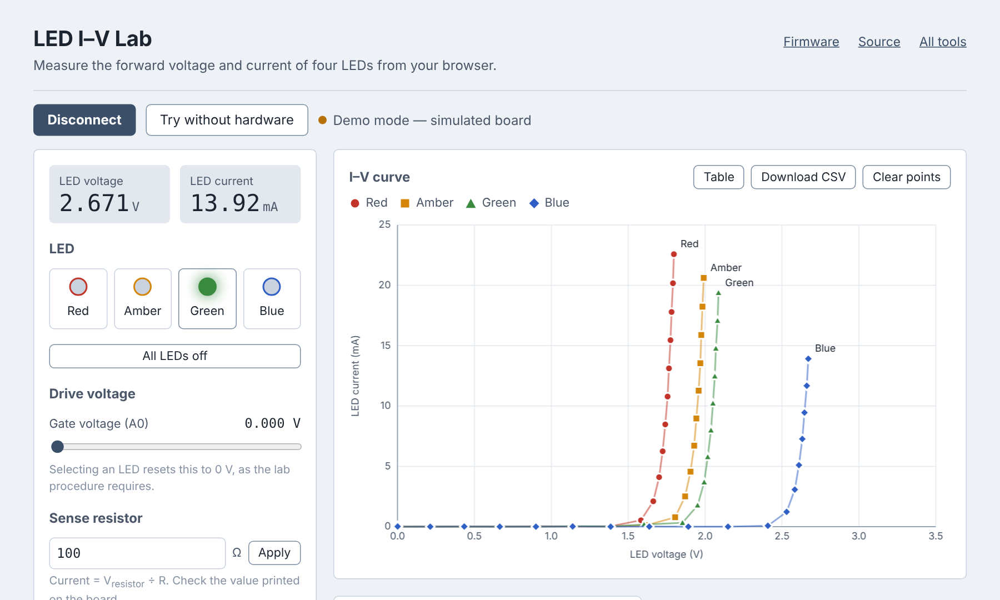

# LED I–V Lab

A browser-based instrument for an undergraduate electronics lab. Students select
one of four LEDs (red, amber, green, blue), sweep the drive voltage, and watch the
forward voltage and current plot live — straight from an Adafruit ItsyBitsy M4
over USB, with nothing to install.

**Use it:** https://interactive-hardware-interfacing.github.io/led-iv-lab/

Works in Chrome and Edge (they implement [Web Serial](https://developer.mozilla.org/en-US/docs/Web/API/Web_Serial_API)).
The page also has a *Try without hardware* mode with a simulated board, so it can
be previewed anywhere.

<p align="center"></p>

## What's in the repo

| Path | What it is |
|---|---|
| `index.html` | The whole web instrument. One self-contained file: controls, I–V chart, sweep, CSV export, serial log, firmware instructions. |
| `PROTOCOL.md` | The serial protocol. This is the contract between the page and whatever firmware is on the board. |
| `firmware/arduino/led_iv_lab/` | Arduino (C++) firmware — the default. Built to a `.uf2` by CI. |
| `firmware/circuitpython/code.py` | CircuitPython firmware speaking the same protocol, kept as a swap-in option. |
| `.github/workflows/firmware.yml` | Compiles the Arduino sketch and attaches `led_iv_lab.uf2` to each release. |
| `.github/workflows/pages.yml` | Publishes `index.html` to GitHub Pages. |

## Hardware

- Adafruit ItsyBitsy M4 (SAMD51)
- The lab's LED board (prebuilt PCB): four LEDs with switches, a FET driven from
  the DAC, a sense resistor, and two analog-routing switches so one ADC pin can
  read either the LED voltage or the sense-resistor voltage.

| ItsyBitsy pin | Role |
|---|---|
| A0 (DAC) | FET gate drive, 0–3.3 V |
| A1 (ADC) | Measurement node |
| D5, D7, D9, D10 | Red, Amber, Green, Blue LED switches |
| D11 | Route A1 to the LED voltage |
| D12 | Route A1 to the sense-resistor voltage |

Note that D5 on the ItsyBitsy M4 is output-only and drives 5 V logic through a
level shifter. That's fine for a switch gate; just don't try to read from it.

## Flashing the Arduino firmware (default)

1. Download `led_iv_lab.uf2` from the [latest release](https://github.com/interactive-hardware-interfacing/led-iv-lab/releases/latest).
2. Plug the board in and double-tap the reset button. A drive called `ITSYM4BOOT` appears.
3. Drag the `.uf2` onto it. The board reboots into the lab firmware.

To build it yourself, open `firmware/arduino/led_iv_lab/led_iv_lab.ino` in the
Arduino IDE with the Adafruit SAMD board package installed and select
*Adafruit ItsyBitsy M4*. Or with `arduino-cli`:

```sh
arduino-cli core install adafruit:samd --additional-urls https://adafruit.github.io/arduino-board-index/package_adafruit_index.json
arduino-cli compile --fqbn adafruit:samd:adafruit_itsybitsy_m4 --output-dir build firmware/arduino/led_iv_lab
```

## Swapping to CircuitPython (optional)

If testing shows the CircuitPython build is preferable:

1. Download CircuitPython for the ItsyBitsy M4 from https://circuitpython.org/board/itsybitsy_m4_express/ and drag that `.uf2` onto `ITSYM4BOOT`.
2. A `CIRCUITPY` drive appears. Copy `firmware/circuitpython/code.py` onto it.

The web page does not change. Both firmwares answer `ID` with `ID LEDLAB …`, and
everything else is identical. Expect a lower measurement rate and more timing
jitter from CircuitPython.

## Talking to the board without the page

Any serial terminal works (115200, line ending `\n`):

```
> ID
ID LEDLAB 1.0.0 arduino ItsyBitsyM4
> LED G
OK LED G
> SET 2.4
OK SET 2.400
> MEAS
M 2.051 0.011230 1.123 2.400 G
```

Full command list in [PROTOCOL.md](PROTOCOL.md), or type `HELP`.

## Calibration notes

- The DAC and ADC are both assumed to be referenced to exactly 3.3 V. If a
  meter disagrees, adjust `DAC_FULL_SCALE_V` / `ADC_FULL_SCALE_V` at the top
  of the firmware.
- The sense resistor defaults to 100 Ω on both the board and the page. Set the
  real value on the page (it's sent to the board with `R <ohms>`) or change
  the default in the firmware.
- Each `MEAS` takes ≈50 ms: 25 ms settling before each of the two ADC reads,
  per the lab procedure.

## Safety behaviour

The firmware turns every LED switch off and sets the DAC to 0 V on power-up,
on `LED OFF`, when the USB host disconnects, and the page sends `LED OFF`
before it closes the port. Sweeps end at 0 V.

## Releasing

Releases are tagged `vX.Y.Z`. Pushing a tag builds the Arduino firmware and
attaches `led_iv_lab.uf2` to the release, which is where the page's download
link points. Before tagging:

1. Bump `FW_VERSION` in both firmware files and the version string in the
   `index.html` footer so the three agree.
2. Add an entry to `CHANGELOG.md`.
3. `git tag v1.0.0 && git push origin main --tags`
4. Watch the *firmware* workflow finish, then open the release and confirm the
   `.uf2` is attached.

## License

GPL-2.0 — see [LICENSE](LICENSE). The same license as the maintainer's
[tinySA_python](https://github.com/LC-Linkous/tinySA_python) and
[nanoVNA_python](https://github.com/LC-Linkous/nanoVNA_python) libraries.
